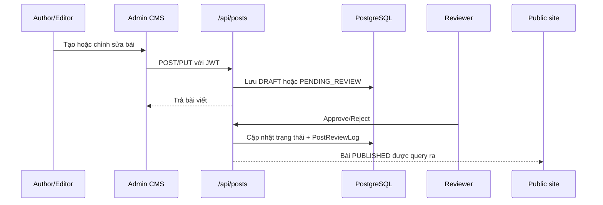
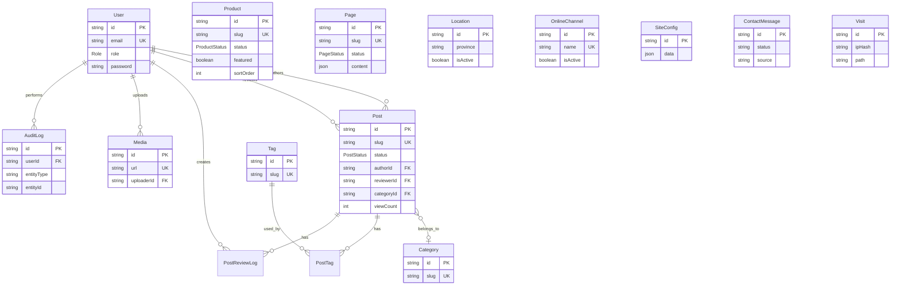

# THIẾT KẾ HỆ THỐNG ACBT WEB

**Mã tài liệu:** ACBT-ARCH-001  
**Ngày cập nhật:** 04/08/2026  
**Phiên bản:** 1.0  
**Mốc mã nguồn tham chiếu:** `6756179`

## 1. Mục tiêu và phạm vi

ACBT Web là hệ thống website thương hiệu kết hợp CMS quản trị nội dung. Hệ thống phục vụ hai nhóm người dùng:

- Khách truy cập: xem thương hiệu, sản phẩm, tin tức, chất lượng, điểm bán và gửi liên hệ.
- Nhân sự nội bộ: quản trị nội dung, media, sản phẩm, kênh bán, liên hệ khách hàng, người dùng và cấu hình website.

Thiết kế này mô tả kiến trúc hiện tại trong mã nguồn, cách các thành phần trao đổi dữ liệu, mô hình dữ liệu và hướng vận hành production. Đây là tài liệu baseline để phát triển và tiếp nhận; các quyết định mở rộng cần cập nhật lại tài liệu này.

## 2. Nguyên tắc thiết kế

1. Dùng Next.js App Router làm lớp trình bày và API trong cùng một ứng dụng.
2. Public page ưu tiên Server Component và đọc dữ liệu qua feature layer.
3. Client Component chỉ dùng khi cần state, event handler, animation, form hoặc local storage.
4. API route mỏng: đọc request, xác thực/phân quyền, gọi feature layer, trả JSON.
5. Trạng thái nội dung phải được biểu diễn rõ trong database, đặc biệt với bài viết có quy trình duyệt.
6. Media được lưu ngoài database dưới dạng file; database lưu metadata và URL tham chiếu.
7. Nội dung cấu hình linh hoạt được lưu dạng JSON trong `SiteConfig`, có hàm normalize/default để tránh hỏng giao diện khi thiếu dữ liệu.
8. Các thay đổi quản trị quan trọng ghi vào `AuditLog`; thông báo Telegram là tích hợp tùy chọn.

## 3. Kiến trúc tổng thể

```mermaid
flowchart LR
    U[Khách truy cập / Nhân sự CMS] --> B[Trình duyệt]
    B --> N[Nginx hoặc reverse proxy]
    N --> APP[Next.js standalone\nApp Router + React]

    APP --> PUB[Public pages\nServer/Client Components]
    APP --> ADM[Admin CMS\nProtectedRoute + AuthContext]
    APP --> API[Route Handlers\n/api/*]

    API --> AUTH[JWT + bcrypt\nAuthZ theo role]
    API --> F[Feature layer\nproducts / posts / domain logic]
    F --> P[Prisma Client]
    API --> P
    P --> DB[(PostgreSQL)]

    API --> FS[Local upload storage\nUPLOAD_DIR]
    FS --> STATIC[/uploads URL]
    API -. tùy chọn .-> TG[Telegram Bot API]
    API --> EXT[Link/kênh bán bên ngoài\nShopee, TikTok, Lazada, social]
```

### 3.1. Các lớp chính

| Lớp | Vị trí | Trách nhiệm |
|---|---|---|
| Presentation | `src/app/`, `src/components/` | Route, layout, page, form, UI, animation |
| Domain/feature | `src/features/` | Query, mutation và quy tắc theo domain |
| Shared application | `src/lib/` | Auth, authorization, Prisma, slug, upload, config, rate limit, audit |
| Persistence | `prisma/` | Schema, enum, relation và migration |
| Static/media | `public/`, `UPLOAD_DIR` | Logo, hero, hình ảnh tĩnh và media upload |
| Operations | `scripts/`, `docs/` | Seed, migrate media, deploy, backup, kiểm tra |

## 4. Phân rã chức năng

### 4.1. Public website

- **Home:** banner, sản phẩm nổi bật, câu chuyện thương hiệu, bằng chứng chất lượng, tin tức, CTA; dữ liệu lấy từ product/post/site config/marketing config.
- **Product:** danh sách, bộ sưu tập, chi tiết theo slug; product có trạng thái, thứ tự hiển thị, hình ảnh, giá, thành phần và JSON mở rộng.
- **News:** danh sách và bài chi tiết; bài có category, tag, SEO metadata, view count và related posts.
- **About:** giới thiệu, lịch sử, thành tựu, cộng đồng; nhiều nội dung cấu hình từ `marketing_assets`.
- **Quality:** thông tin nguồn nguyên liệu, nhà máy, hồ sơ, chính sách, FAQ; cấu hình tại `quality_page`.
- **Sales/distribution:** điểm bán, kênh online, bản đồ/danh sách; dữ liệu từ `Location`, `OnlineChannel` và JSON tĩnh nếu có.
- **Contact/partnership:** biểu mẫu ghi vào `ContactMessage`, giới hạn request và tùy chọn gửi Telegram.
- **Dynamic pages:** nội dung mở rộng từ model `Page` tại `/trang/[slug]`.

### 4.2. CMS

- **Content management:** bài viết, category, tag, editor rich text, SEO và review workflow.
- **Product management:** CRUD sản phẩm, trạng thái, featured, sort order, chọn sản phẩm hiển thị ở hero/showcase.
- **Website control:** cấu hình trang chủ, marketing, quality, partnership, page assets, navbar/footer và các nội dung mở rộng.
- **Media library:** upload ảnh có kiểm tra MIME thật, giới hạn dung lượng, sanitize tên file và ghi metadata `Media`.
- **Sales channels:** CRUD `Location` và `OnlineChannel`, bật/tắt và sắp thứ tự.
- **Customer contacts:** đọc, lọc, đổi trạng thái `NEW/READ/RESPONDED`, xóa theo quyền.
- **Administration:** người dùng, trạng thái hệ thống và nhật ký hoạt động.
- **Media intelligence:** thu thập, phân tích, xuất dữ liệu theo module admin riêng.

## 5. Luồng xử lý chính

### 5.1. Khách xem trang public

1. Browser gửi request tới reverse proxy.
2. Next.js App Router chọn page theo path.
3. Page gọi query/Prisma hoặc API cần thiết.
4. Dữ liệu được normalize URL media và cấu hình mặc định.
5. Server trả HTML/RSC; client tiếp tục hydrate phần có animation, filter, form hoặc tương tác.
6. `AnalyticsTracker` có thể gửi lượt truy cập tới `/api/analytics/track`.

### 5.2. Đăng nhập CMS

1. `POST /api/auth/login` nhận email/mật khẩu.
2. Rate limit theo IP: tối đa 5 lần trong 5 phút.
3. Mật khẩu được kiểm tra bằng bcrypt.
4. Hệ thống phát JWT thời hạn 7 ngày, trả token và đặt cookie `auth_token`.
5. Client lưu token để gọi API Bearer và `/api/auth/me` kiểm tra phiên.
6. Đăng nhập thành công ghi audit log và có thể gửi Telegram nếu đã cấu hình.

### 5.3. Xuất bản bài viết



Trạng thái bài viết: `DRAFT`, `PENDING_REVIEW`, `PUBLISHED`, `REJECTED`, `ARCHIVED`, `SCHEDULED`, `DELETED`. Tác giả không được xuất bản trực tiếp theo mutation hiện tại.

### 5.4. Upload media

1. CMS gửi multipart file tới `POST /api/admin/upload`.
2. API kiểm tra JWT và role `SUPER_ADMIN/ADMIN/EDITOR/MARKETING`.
3. Rate limit upload theo IP: 30 request/phút.
4. Kiểm tra kích thước và MIME thực bằng `file-type`.
5. Tạo key dạng `media/<timestamp>-<sanitized-name>.<ext>`.
6. Ghi file vào `UPLOAD_DIR`, trả URL public và cố gắng ghi record `Media`.
7. Nginx/reverse proxy phải phục vụ URL `/uploads` từ đúng thư mục này.

## 6. Mô hình dữ liệu



### 6.1. Ghi chú thiết kế dữ liệu

- `SiteConfig` dùng các key logic như `global`, `marketing_assets`, `quality_page`, `partnership_page` để lưu cấu hình theo khu vực.
- `Product.specs`, `variants`, `stats`, `processSteps` và `Page.content` là JSON để hỗ trợ nội dung linh hoạt.
- `PostTag` là bảng nối có khóa chính kép `postId + tagId`.
- Các slug của `Post`, `Product`, `Page`, `Category` và `Tag` phải duy nhất.
- `AuditLog` không nên bị xóa trong quy trình nghiệp vụ thông thường; cần có chính sách lưu trữ riêng nếu dữ liệu tăng nhanh.
- `Visit.ipHash` được thiết kế để lưu hash IP thay vì IP thô.

## 7. API và route chính

### 7.1. Authentication

| Method | Endpoint | Mục đích |
|---|---|---|
| POST | `/api/auth/login` | Đăng nhập, rate limit, cấp JWT/cookie |
| POST | `/api/auth/logout` | Đăng xuất |
| GET | `/api/auth/me` | Kiểm tra phiên hiện tại |

### 7.2. Nội dung và catalog

| Nhóm | Endpoint |
|---|---|
| Products | `/api/products`, `/api/products/[id]`, `/api/products/slug/[slug]` |
| Posts | `/api/posts`, `/api/posts/[id]`, `/api/posts/slug/[slug]`, `/api/posts/review`, `/api/posts/approve` |
| Categories | `/api/categories`, `/api/categories/[id]` |
| Pages | `/api/pages`, `/api/pages/[id]`, `/api/pages/slug/[slug]` |
| Search | `/api/search` |

### 7.3. Website, bán hàng và khách hàng

| Nhóm | Endpoint |
|---|---|
| Site settings | `/api/settings`, `/api/settings/marketing`, `/api/settings/quality`, `/api/settings/partnership` |
| Sales | `/api/locations`, `/api/locations/[id]`, `/api/online-channels`, `/api/online-channels/[id]`, `/api/distribution-points` |
| Contacts | `/api/contacts`, `/api/contacts/[id]` |
| Analytics | `/api/analytics/track` |

### 7.4. Quản trị và vận hành

| Nhóm | Endpoint |
|---|---|
| Users | `/api/users`, `/api/users/[id]` |
| Admin dashboard | `/api/admin/stats`, `/api/admin/system`, `/api/admin/notifications` |
| Media | `/api/admin/media`, `/api/admin/upload` |
| Activity | `/api/admin/activity-logs` |
| Media intelligence | `/api/admin/media-intelligence`, `/crawl`, `/export` |
| Product transfer | `/api/admin/products/import`, `/api/admin/products/export` |

## 8. Authentication, authorization và bảo mật

### 8.1. Authentication hiện tại

- Mật khẩu hash bằng bcrypt.
- JWT ký bằng `JWT_SECRET`, thời hạn 7 ngày.
- API đọc token từ `Authorization: Bearer ...` hoặc cookie `auth_token`.
- Cookie production nên được bật `secure` thông qua HTTPS; thuộc tính hiện tại gồm `httpOnly`, `sameSite=strict`, `path=/`.
- Không commit `.env` hoặc secret vào repository.

### 8.2. Authorization

CMS lọc menu theo role ở `src/lib/admin-navigation.ts`; API kiểm tra lại độc lập bằng `requireRole` hoặc kiểm tra payload. Một số nhóm quyền chính:

| Vai trò | Phạm vi nghiệp vụ chính |
|---|---|
| `SUPER_ADMIN` | Toàn hệ thống |
| `ADMIN` | Quản trị CMS, người dùng và cấu hình |
| `EDITOR` | Nội dung, sản phẩm, danh mục và duyệt bài theo API |
| `AUTHOR` | Bài viết; không tự publish |
| `MARKETING` | Nội dung thương hiệu, cấu hình marketing, media và một số catalog |
| `SUPPORT` | Tiếp nhận/xử lý liên hệ |
| `USER` | Không thuộc khu vực CMS |

### 8.3. Bảo mật cần duy trì

- Giữ `JWT_SECRET` đủ dài và thay khi nghi ngờ lộ secret.
- Đặt HTTPS và `AUTH_COOKIE_SECURE=true` khi cần ép secure cookie.
- Giới hạn kích thước/MIME upload và chống path traversal; không nới lỏng kiểm tra trong `local-storage.ts`.
- Rate limit hiện là memory-based, chỉ phù hợp một instance.
- Lọc/escape nội dung rich text khi render; giữ cơ chế DOMPurify hiện có.
- Không gửi mật khẩu hoặc token vào audit log, Telegram và log server.
- Backup database và thư mục upload theo cùng mốc thời gian.

## 9. Thiết kế triển khai production

```mermaid
flowchart TD
    DNS[DNS + HTTPS] --> NG[Nginx]
    NG -->|/| WEB[Next.js standalone\nPM2 hoặc systemd]
    NG -->|/uploads| UP[/var/www/acbt-uploads]
    WEB --> DB[(PostgreSQL local hoặc managed)]
    WEB --> UP
    WEB -. optional .-> TELE[Telegram API]
    DB --> B1[pg_dump backup]
    UP --> B2[Archive uploads backup]
```

### 9.1. Quy trình phát hành

```bash
npm ci
npm run db:migrate:deploy
npm run typecheck
npm run build
npm run start
```

Nếu dùng PM2:

```bash
pm2 start npm --name acbt-web -- run start
pm2 save
```

### 9.2. Backup và khôi phục

Backup tối thiểu gồm:

```bash
pg_dump "$DATABASE_URL" > backup-acbt.sql
tar -czf backup-acbt-uploads.tar.gz /var/www/acbt-uploads
```

Khi khôi phục phải khôi phục database và uploads cùng phiên bản. Sau đó chạy `node scripts/check-db.js`, kiểm tra ảnh, đăng nhập CMS và một luồng gửi liên hệ.

## 10. Khả năng mở rộng và vận hành

### Hiện tại phù hợp với

- Một ứng dụng Next.js chạy standalone.
- Một PostgreSQL.
- Một thư mục upload dùng chung.
- Một instance hoặc số instance ít, có reverse proxy ổn định.

### Khi cần mở rộng

1. Chuyển rate limit memory sang Redis/Upstash để dùng chung giữa các instance.
2. Chuyển media sang object storage/CDN nếu lưu lượng và dung lượng tăng.
3. Dùng queue cho crawl media intelligence, Telegram và tác vụ nặng.
4. Bổ sung structured logging, error tracking và health check chủ động.
5. Thêm pagination cho danh sách lớn như posts, media, contacts và audit logs.
6. Bổ sung test tự động cho auth, authorization, upload, content workflow và migration.
7. Tách read/write hoặc cache theo nhu cầu khi traffic public tăng.

## 11. Rủi ro và việc cần xử lý

| Mức độ | Vấn đề | Hướng xử lý |
|---|---|---|
| Cao | Redirect `/daiviet`, `/dv`, `/tmdt` đang trỏ dev tunnel | Xác nhận URL thật hoặc xóa trước production |
| Cao | Secret và tài khoản seed | Không dùng dữ liệu mẫu; rotate và cấp lại qua kênh bảo mật |
| Cao | Upload local là stateful | Backup riêng, giới hạn quyền thư mục, kiểm tra mapping Nginx |
| Trung bình | Rate limit memory-based | Dùng Redis khi chạy nhiều instance |
| Trung bình | Cấu hình JSON linh hoạt | Có versioning/backup trước khi thay đổi lớn |
| Trung bình | Một số nội dung phụ thuộc external links | Kiểm tra định kỳ link bán hàng và social |

## 12. Ma trận truy vết mã nguồn

| Nhu cầu | Tệp chính |
|---|---|
| Auth/JWT | `src/lib/auth.ts`, `src/lib/authz.ts`, `src/lib/auth-context.tsx` |
| Database | `src/lib/prisma.ts`, `prisma/schema.prisma` |
| Product domain | `src/features/products/queries.ts`, `src/features/products/mutations.ts` |
| Post domain | `src/features/posts/queries.ts`, `src/features/posts/mutations.ts` |
| Site config | `src/lib/site-config.ts`, `src/lib/site-config-defaults.ts` |
| Marketing config | `src/lib/marketing-config.ts` |
| Local media | `src/lib/local-storage.ts`, `src/lib/upload-url.ts` |
| Rate limit | `src/lib/rate-limit.ts` |
| Audit/Telegram | `src/lib/audit.ts`, `src/lib/telegram.ts` |
| Public layout | `src/app/layout.tsx`, `src/components/layout/` |
| Admin layout | `src/app/admin/layout.tsx`, `src/components/admin/` |
| Deploy | `next.config.ts`, `scripts/deploy-vps.sh`, `start-production.bat` |
